

<a href="#personagem"><picture><source media="(max-width: 600px)" srcset="./assets/pt/m/hero.svg"/></picture></a>

<a href="#personagem"></a>
<a href="#inventario"></a>
<a href="#missoes"></a>

<a href="#conquistas"></a>
<a href="#contato"></a>

<picture><source media="(max-width: 600px)" srcset="./assets/pt/m/banners/01.svg"/></picture>

<picture><source media="(max-width: 600px)" srcset="./assets/pt/m/character.svg"/></picture>

<picture><source media="(max-width: 600px)" srcset="./assets/pt/m/dialog.svg"/></picture>

<picture><source media="(max-width: 600px)" srcset="./assets/pt/m/skills.svg"/></picture>

<picture><source media="(max-width: 600px)" srcset="./assets/pt/m/banners/02.svg"/></picture>

<picture><source media="(max-width: 600px)" srcset="./assets/pt/m/inventory.svg"/></picture>

<picture><source media="(max-width: 600px)" srcset="./assets/pt/m/banners/03.svg"/></picture>

<a href="https://evertonsantos-pied.vercel.app/projetos/peopleos"><picture><source media="(max-width: 600px)" srcset="./assets/pt/m/missions/peopleos.svg"/></picture></a>

<picture><source media="(max-width: 600px)" srcset="./assets/pt/m/missions/flow.svg"/></picture>

<a href="https://github.com/EvertonSantosBR/LIBRAS-Bridge"><picture><source media="(max-width: 600px)" srcset="./assets/pt/m/missions/libras-bridge.svg"/></picture></a>

<a href="https://github.com/EvertonSantosBR/GreenChain"><picture><source media="(max-width: 600px)" srcset="./assets/pt/m/missions/greenchain.svg"/></picture></a>

<a href="https://github.com/EvertonSantosBR/BiblioControle"><picture><source media="(max-width: 600px)" srcset="./assets/pt/m/missions/bibliocontrole.svg"/></picture></a>

<a href="https://github.com/EvertonSantosBR/APPWEB---IEL"><picture><source media="(max-width: 600px)" srcset="./assets/pt/m/missions/appweb-iel.svg"/></picture></a>

<a href="https://github.com/EvertonSantosBR/CadastroApp"><picture><source media="(max-width: 600px)" srcset="./assets/pt/m/archive/cadastroapp.svg"/></picture></a>

<a href="https://github.com/EvertonSantosBR/StoreManagement"><picture><source media="(max-width: 600px)" srcset="./assets/pt/m/archive/storemanagement.svg"/></picture></a>

<a href="https://github.com/EvertonSantosBR/Usurport"><picture><source media="(max-width: 600px)" srcset="./assets/pt/m/archive/usurport.svg"/></picture></a>

<picture><source media="(max-width: 600px)" srcset="./assets/pt/m/banners/04.svg"/></picture>

<picture><source media="(max-width: 600px)" srcset="./assets/pt/m/status.svg"/></picture>

<picture>
  <source media="(prefers-color-scheme: dark)" srcset="./assets/generated/snake-dark.svg"/>
  <source media="(prefers-color-scheme: light)" srcset="./assets/generated/snake-light.svg"/>
  
</picture>

<picture><source media="(max-width: 600px)" srcset="./assets/pt/m/banners/05.svg"/></picture>

<picture><source media="(max-width: 600px)" srcset="./assets/pt/m/achievements.svg"/></picture>

<picture><source media="(max-width: 600px)" srcset="./assets/pt/m/banners/06.svg"/></picture>

<picture><source media="(max-width: 600px)" srcset="./assets/pt/m/continue.svg"/></picture>

<a href="mailto:evertnsantos.work@gmail.com"></a>
<a href="https://evertonsantos-pied.vercel.app/"></a>

<a href="#topo"><picture><source media="(max-width: 600px)" srcset="./assets/pt/m/footer.svg"/></picture></a>
